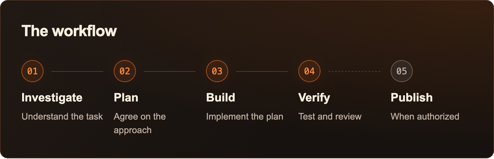
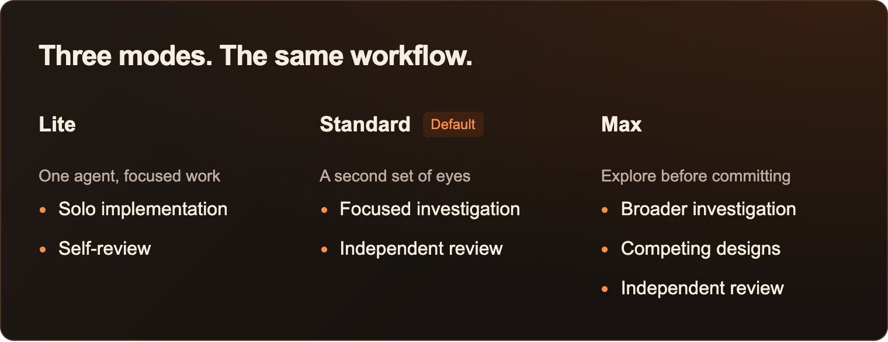

# Forge

Forge is a set of agent skills for coding work. One coordinating skill, `forge`, takes a task from investigation through design, implementation, verification and publication, routing each step to a focused skill, principle or playbook. Start with [Forge](skills/forge/SKILL.md), [the guide](docs/guide/README.md), or [setup](skills/forge-setup/SKILL.md).

Its skills cover investigation, design, review, research, writing and publishing. No particular organization, issue tracker or model provider is required for the core workflow.

This repository is both the `forge` plugin and a plugin marketplace named `logan-hunt` that lists it.

## The workflow



Read-only and planning requests stop at the requested outcome. Publication needs authorization for the task.

## Choose a mode

The mode changes the depth of investigation and review.



## Install

### Claude Code

```sh
claude plugin marketplace add logan-hunt/forge
claude plugin install forge@logan-hunt
```

Inside a session, `/plugin marketplace add logan-hunt/forge` followed by `/plugin install forge@logan-hunt` does the same. Plugin skills are namespaced: `/forge:forge`, `/forge:forge-lite`, `/forge:forge-max` and `/forge:forge-setup`.

### Codex

```sh
codex plugin marketplace add logan-hunt/forge
codex plugin add forge@logan-hunt
```

You can also browse the marketplace with `/plugins` inside Codex.

### Cursor

In Agent chat, run `/add-plugin https://github.com/logan-hunt/forge`. Team admins can add the repository under **Dashboard → Plugins → Team Marketplaces → Add Marketplace**.

### GitHub Copilot CLI

```sh
copilot plugin marketplace add logan-hunt/forge
copilot plugin install forge@logan-hunt
```

### Local checkout

Clone the repository, or keep it in a user directory such as `~/.agents/forge`, and link the skills from its root. Both commands preview the changes. Add `--apply` to create current links and remove direct links to retired Forge skills.

```sh
git clone https://github.com/logan-hunt/forge.git
cd forge
python3 scripts/activate-forge.py --scope user
python3 scripts/activate-forge.py --scope project --project /path/to/project
```

The script exposes skills through `.agents/skills`, `.claude/skills` and `.cursor/skills` at the selected scope. Use repeated `--host agents|claude|cursor` flags to select roots. Existing skills are preserved; collisions stop installation. `--remove --apply` removes current skill links that resolve to this package and direct links to its retired skills. It preserves indirect links to retired skills. Keep the checkout in place while links or hook commands refer to it. Symlink installation needs filesystem support for symlinks.

When upgrading, use [How](skills/how/SKILL.md) for former Teach walkthroughs. Ponytail’s [Simplify existing code](skills/ponytail/SKILL.md#simplify-existing-code) section replaces Laziness Protocol and Subtract Before You Add. Find the other former principle skills by task in the [Forge principles index](skills/forge/references/principles.md). Forge and its playbooks load these references on demand. Start a new session to refresh skill discovery.

Forge 0.4 uses the following command names.

Former command | Current command
--- | ---
`figure-it-out` | [`plan-complex-work`](skills/plan-complex-work/SKILL.md)
`in-your-own-words` | [`restate-goal`](skills/restate-goal/SKILL.md)
`interrogate` | [`adversarial-review`](skills/adversarial-review/SKILL.md)
`ketchup` | [`recap-chat`](skills/recap-chat/SKILL.md)
`no-comments` | [`review-comments`](skills/review-comments/SKILL.md)
`recall` | [`total-recall`](skills/total-recall/SKILL.md)
`sharpen` | [`refine-prompt`](skills/refine-prompt/SKILL.md)
`statechart` | [`statechart-diagram`](skills/statechart-diagram/SKILL.md)
`typescript-best-practices` | Removed. Follow your repository’s TypeScript conventions.
`unslop` | [`clarify-writing`](skills/clarify-writing/SKILL.md)

Git Prune is no longer bundled. Use your own cleanup procedure or separately installed skill.

## Hook and settings

Installing the plugin does not install hooks or replace user instructions. Run `forge-setup` for the optional Forge hook, which reports the Forge mode and Ponytail level, for the selected hosts and scope. From the repository root:

```sh
python3 scripts/install-forge-hooks.py --scope user --default-mode standard --ponytail full
python3 scripts/install-forge-hooks.py --scope project --project /path/to/project
```

Both commands preview. Add `--apply` for an authorized installation, or `--remove --apply` for removal. Backups preserve changed settings. New sessions and the host's trust flow may be required. Hook installation supports Claude Code and Codex; Cursor packaging and discovery do not imply Cursor hook support. The hook installer emits POSIX-style commands; Windows host loading is not verified.

## Configure models

Ordinary unconfigured roles inherit the active model. Resolve effective settings with `python3 scripts/forge_config.py --project /path/to/project`. User settings, including `defaultMode` and the `ponytail` level, are in `~/.config/forge/config.json`; project settings in `~/.config/forge/projects/<project>-<hash>.json` override them by role. Backups of changed settings go to `~/.config/forge/backups/`. Store a model selection object, a panel array, or null to restore the workflow default. See [forge-setup](skills/forge-setup/SKILL.md) for preview/apply commands and live capability validation. Customization does not edit installed package files.

Standard and Max use a separate reviewer agent, preferring another available provider. Same-provider review is supported.

## Workflow and host support

[Forge policy](docs/policy.md) defines required plan approval, review and publication boundaries. Full-send is an explicit task-scoped grant. Repository instructions and user authorization govern PR comments, reviews and thread resolution. Git helpers follow the repository's conventions; ticket creation is conditional on its workflow. Graphite is used only when already configured and usable.

T3 and native Claude Code have [host adapters](docs/harness/README.md). Other hosts use their current tools and limitations. Read-only requests remain nonmutating. Manifests and command names alone do not prove runtime discovery or delegation. Python 3.10+ is required for setup, configuration and the Forge hook. The [Statechart Diagram skill](skills/statechart-diagram/SKILL.md) has separate TypeScript, Java/TLC and first-run download requirements documented in its skill.

## Repository layout

| Path | Contents |
| --- | --- |
| [`.claude-plugin/`](.claude-plugin/), [`.codex-plugin/`](.codex-plugin/), [`.cursor-plugin/`](.cursor-plugin/) | Plugin manifests, plus the Claude Code and Cursor marketplace files |
| [`.agents/plugins/`](.agents/plugins/marketplace.json) | The Codex marketplace file |
| [`skills/`](skills/) | All skills, one folder each |
| [`docs/`](docs/guide/README.md) | Policy, the guide and host adapters |
| [`hooks/`](hooks/), [`scripts/`](scripts/), [`tests/`](tests/) | The Forge hook, setup and release scripts, and their tests |

## Check the package

```sh
python3 -m venv .venv
.venv/bin/python -m pip install -r requirements-dev.txt
.venv/bin/python -B scripts/check-release.py
claude plugin validate .
```

Tests use temporary homes and repositories. They do not install hooks into the current user's environment. PyYAML is needed only for development validation. The Statechart Diagram suite is separate under `skills/statechart-diagram/scripts`. Report runtime host loading separately from static and isolated verification.

To release a change, bump `version` in all three plugin manifests: `.claude-plugin/plugin.json`, `.codex-plugin/plugin.json` and `.cursor-plugin/plugin.json`.

See [team preparation](docs/sharing.md) for core entry points, optional and advanced methods, host smoke checks and workflow behavior cases.
